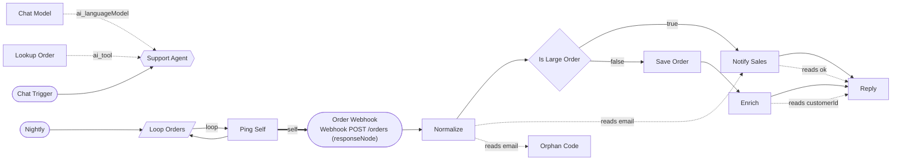
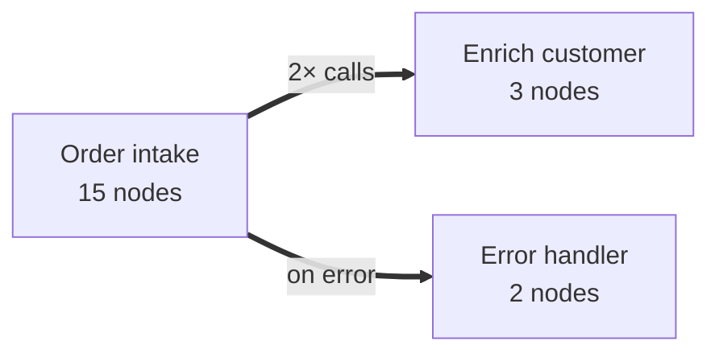

# flownav

[](https://github.com/OmerTurkenits/flownav/actions/workflows/ci.yml)

**A typed node graph for n8n workflows, so an AI agent (or you) can navigate a workflow without reading raw JSON.**

flownav turns exported workflow JSON, or a live n8n instance, into a queryable graph: connections, AI agent tools and models, expression references between nodes, cross-workflow calls, credentials and shared resources. An agent asks for one node's card or "what breaks if I rename this?" and gets a few lines back instead of thousands of lines of JSON.

It is read-only against n8n. Inspired by [graphify](https://github.com/safishamsi/graphify), which does the same for code.

## Why

- **Token cost.** A real workflow export is large and mostly noise. `flownav explain "Node"` is about ten lines.
- **The rename gap.** When you rename or delete a node, n8n updates the connections but not `$('Old Name')` inside other nodes' expressions or Code nodes. Those silently break. `flownav affected "Old Name" --rename` lists exactly which nodes and parameters will break, before you change anything.
- **Cross-workflow structure.** Sub-workflows, agent tool workflows, error workflows and webhook-to-webhook calls become edges, so you can ask what calls what across your whole instance.

## Install

Needs Node 22.12 or newer.

```bash
npm install -g flownav      # then use: flownav ...   (or the short alias: fnav)
# or without installing:
npx flownav --help
```

## Try it in a minute

The repo ships three small example workflows in [`examples/`](examples). They contain deliberately planted problems.

```bash
git clone https://github.com/OmerTurkenits/flownav && cd flownav
flownav build examples        # -> .flownav/graph.json and .flownav/WORKFLOW_REPORT.md
flownav check
flownav view --open           # interactive graph in your browser
```

## An example graph

`examples/orders.json` is a webhook that routes orders, calls a sub-workflow, has an AI agent with a tool, a loop, and a Code node with problems. This is what `flownav diagram wf-orders` draws (GitHub renders it):



Solid arrows are connections (with branch labels such as `true`/`false`/`loop`). Dotted arrows are AI sub-nodes and expression reads (`reads email` means the node uses the `email` field of another node by name). Thick arrows are cross-workflow or webhook calls. Triggers are rounded, IF/Switch are diamonds, agents are hexagons.

With `--collapse` you get one box per workflow, which is the readable view for many workflows (`flownav diagram --collapse`):



## Example queries

Everything below is real output from the examples.

**A node's card**

```text
$ flownav explain "Is Large Order"
wf-orders:Is Large Order  [if v2]  (group "Intake")
  IF 1 condition(s)
inputs:
  ← wf-orders:Normalize
outputs:
  [0 true] → wf-orders:Notify Sales
  [1 false] → wf-orders:Save Order
```

**What breaks if I rename this node?**

```text
$ flownav affected "Normalize" --rename
wf-orders:Normalize — impact of rename
2 node(s) reference "Normalize" by name and will break unless their expressions are rewritten:
  × wf-orders:Notify Sales uses {email}  in text
  × wf-orders:Orphan Code uses {email}  in jsCode
```

**A path, even across workflows**

```text
$ flownav path "Save Order" "Shape"
1 shortest path(s), 4 hop(s):
#1 wf-orders:Save Order —main→ wf-orders:Enrich —calls EXTRACTED→ wf-enrich:When called —main→ wf-enrich:Fetch CRM —main→ wf-enrich:Shape
```

**An AI agent as a card**

```text
$ flownav explain "Support Agent"
wf-orders:Support Agent  [agent v1.7]
  AI Agent
inputs:
  ← wf-orders:Chat Model [ai_languageModel] (sub-node)
  ← wf-orders:Lookup Order [ai_tool] (sub-node)
  ← wf-orders:Chat Trigger
outputs:
  (none)
agent card:
  ai_languageModel: wf-orders:Chat Model
  ai_tool: wf-orders:Lookup Order
```

**Who calls this workflow?**

```text
$ flownav callers wf-enrich
Enrich customer (wf-enrich) is called by 2 edge(s):
  wf-orders:Enrich  (calls EXTRACTED)
  wf-orders:Lookup Order  (calls:tool EXTRACTED)
```

**Health checks**

```text
$ flownav check
6 finding(s)
  ERROR dead-refs          [wf-orders] Orphan Code reads "Deleted Step", which does not exist
  WARN  fragile-reads      [wf-orders] Orphan Code reads $('Normalize') but Normalize is not upstream via main; it may not have run
  WARN  unreachable        [wf-orders] Orphan Code is not reachable from any trigger
  INFO  cycles             [wf-orders] loop (Loop Over Items): Ping Self <-> Loop Orders
  INFO  dead-ends          [wf-orders] Loop Orders output [0 done] is not connected
  INFO  no-error-handler   [wf-enrich] Enrich customer has no error workflow and no node-level error handling
```

`check` exits with code 1 when it finds an `ERROR`, so it can run in CI.

## Using it with an AI agent

```bash
flownav install claude --mcp     # writes .claude/skills/flownav/SKILL.md and .mcp.json
```

This installs a skill that tells the agent to query flownav before reading, renaming or deleting nodes, and registers an MCP server (`flownav serve`, stdio) exposing `flownav_scan`, `explain`, `neighbors`, `path`, `find`, `affected`, `callers`, `calls`, `uses`, `check` and `report`. The server reads `.flownav/graph.json` from the working directory (or `--graph <file>`) and reloads it when the file changes. The skill works without MCP too, as long as the agent can run shell commands.

A typical rename: the agent runs `scan` to find the workflow id, then `affected "wf-orders:Normalize"`, edits the listed expressions together with the rename using whatever tool it has for editing n8n, syncs again, and runs `check` to confirm nothing dangles. flownav does not write to n8n; it tells the agent what is safe.

### When the request is not specific

Tool replies are written for an agent to act on. If a name matches several nodes or workflows, flownav refuses to pick one and says so:

```text
$ flownav explain order
error: "order" matches 5 nodes. Do not guess: ask the user which one they mean. Then use the workflow:node form.
  1. Order intake › Order Webhook  [webhook]  use: wf-orders:Order Webhook
  2. Order intake › Is Large Order  [if]  use: wf-orders:Is Large Order
  3. Order intake › Save Order  [googleSheets]  use: wf-orders:Save Order
  ...
```

If a partial name matches exactly one node, it resolves but the reply starts with a `NOTE:` asking the agent to confirm with the user before changing anything. To search a family of workflows, use `flownav find --match "<part of workflow name>" --name "<part of node name>"` (`--name` searches node names only; `--text` also searches parameters and code). The installed skill tells the agent to stop and ask in these cases. How reliably an agent follows that depends on the agent.

## Seeing the graph

```bash
flownav view --open                       # interactive HTML: pan, zoom, search, click a node for its card
flownav view "My workflow" --open         # one workflow
flownav view --match Order --collapse     # every workflow whose name contains "Order", one box each
flownav view --focus "Some node" --depth 2
flownav diagram --match Order --out orders.md   # Mermaid text instead
```

`view` writes a single self-contained HTML file (no CDN, no network requests, no external fonts). Click a node to dim everything else and see its card and connections; tick or untick edge kinds to declutter. `--collapse` draws one box per workflow with the calls between them. The files contain your node names and webhook paths, so treat them like the workflows themselves.

## Live n8n

```bash
export N8N_API_KEY=...                       # read from the environment, never written to disk or logs
flownav profile add prod --url https://n8n.example.com
flownav sync --profile prod --executions
flownav status --check                       # is the graph stale?
```

Only `GET /api/v1/...` requests are ever sent (`X-N8N-API-KEY` header, cursor pagination). Syncs are incremental: a workflow whose `updatedAt` and `versionId` are unchanged is reused, and `--full` forces a refetch. A read-only API key is enough. Profiles store the URL and the *name* of the environment variable holding the key, never the key.

## What it models

Edges point in the direction of data or control flow and carry a `kind`, an optional `label`, optional `fields`, and a `confidence`.

| kind | meaning | confidence |
|---|---|---|
| `main` | connection; labels `true`/`false`, `case N` or the rule's output name, `loop`/`done`, `error` | EXPLICIT |
| `capability` | `ai_*` sub-node (model, tool, memory) into its agent | EXPLICIT |
| `reads` | an expression or Code node reads another node, with field names (`$('X')`, `$node["X"]`, `$items("X")`) | EXTRACTED |
| `calls` | Execute Workflow / agent tool workflow into the callee's trigger | EXTRACTED by id, INFERRED by name |
| `on_error` | `settings.errorWorkflow` | EXTRACTED |
| `webhook_calls` | HTTP Request to `/webhook/<path>` matched to a Webhook node | INFERRED |
| `responds_via` | Webhook to a reachable Respond to Webhook | EXTRACTED |
| `uses` | node to credential (by id, never the secret) | EXPLICIT |
| `reads_resource` / `writes_resource` / `uses_resource` | same sheet, table, channel, `$env` or `$vars` across nodes | INFERRED / EXTRACTED |

Details that matter:

- Only `{{ }}` blocks inside `=` strings, and the source of Code nodes, are scanned for references. String literals and comments inside code are ignored, so text such as browser JavaScript held in a string (`$('form')`) is not mistaken for a node reference.
- In Code nodes, `$(n)` where `n` iterates a literal list (`for (const n of ["A","B"])`, `.forEach`, `const n = "A"`) yields INFERRED `reads` edges to each name.
- Other dynamic references (computed node names, runtime workflow ids, embedded or URL sub-workflows) are recorded as *unresolved* and listed in the report. They are never guessed.
- Sticky notes are not nodes; nodes inside a sticky's rectangle get its title as their group.

## Commands

```text
flownav build <path>                  files -> graph + report         (--out dir, --no-report)
flownav sync [--profile p | --url u]  live n8n, incremental           (--active --tags --name --project --executions --full)
flownav status [--check]              what is loaded; --check compares with the instance
flownav profile add|list|remove       base URL + the NAME of the env var holding the key
flownav report | scan                 full report | compact inventory
flownav explain <node>
flownav neighbors <node> [--depth N --dir in|out|both --kinds a,b]
flownav path <A> <B> [--max N --kinds a,b]
flownav find [--type --cred --text --name --resource --workflow --match --disabled --trigger]
flownav affected <node> --rename|--delete|--schema|--behavior
flownav callers <workflow> | calls <workflow> | uses --cred <c>
flownav check [--only fragile-reads|dead-refs|cycles|unreachable|dead-ends|no-error-handler|webhook-no-respond]
flownav view [workflow] [--match text --collapse --focus <node> --depth N --out file.html --open]
flownav diagram [workflow] [--match text --collapse --focus <node> --depth N --no-reads --dir LR|TD --out file.md]
flownav diff old.json new.json        what changed between two graphs
flownav install claude [--global] [--mcp]
flownav serve                         MCP server on stdio
```

Global options: `--graph <file>` and `--format text|json`. Nodes are addressed as `Name` or `workflow:Name` (workflow id or name).

## Privacy and safety

- Read-only against n8n: the only network method is `GET`.
- `pinData` (sample execution data) is dropped on load and never stored.
- String parameters are redacted before being kept for search: values under secret-looking keys (`apiKey`, `token`, `password`, `Authorization`, ...) and known token shapes (Bearer, `sk-...`, GitHub, Slack, AWS, JWT).
- Credentials are recorded by id and type only.
- Execution data is not fetched; `--executions` records only the last status per workflow.
- `.flownav/` holds your graph and is git-ignored by this repo. Don't commit it or share the HTML views if your workflows are sensitive.

## Token savings (an estimate, not a benchmark)

This is a back-of-the-envelope model, not a measurement of real agent sessions. Tokens are estimated as characters ÷ 4.

- **n**: nodes the agent would otherwise read; **τ**: tokens per node in raw n8n JSON (assumed 300, it varies a lot: Code and HTML nodes are far heavier than a Set node); **W = n·τ**.
- **S ≈ 1,300 tokens**: flownav's fixed overhead per session (the 11 MCP tool definitions, about 800 tokens, plus the skill, about 500).
- **r ≈ 100 tokens**: a typical reply. `explain` and `affected` replies are tens of tokens; a `scan` of a dozen workflows is a few hundred.
- With prompt caching, text read once costs about 1.25× the first time and about 0.1× on each later turn. For Q questions:
  - raw: `C_raw ≈ W · (1.25 + 0.1·(Q − 1))`
  - flownav: `C_flow ≈ S · (1.25 + 0.1·(Q − 1)) + Q · r`
- Saving = `1 − C_flow / C_raw`.

Raw reading grows with the workflow; a flownav reply depends only on a node's local connections.

**Saving when the agent reads the whole workflow:**

| workflow size | raw tokens | 1 question | 10 questions |
|---|---|---|---|
| 5 nodes | 1,500 | 8% | −18% (costs more) |
| 10 nodes | 3,000 | 54% | 41% |
| 30 nodes | 9,000 | 85% | 80% |
| 132 nodes | 40,000 | 97% | 96% |
| whole instance (443 nodes) | 133,000 | 99% | 99% |

**Saving when the agent searches and reads only a fraction of a 132-node workflow:**

| fraction read | 1 question | 10 questions |
|---|---|---|
| 30% | 89% | 85% |
| 20% | 83% | 78% |
| 10% | 66% | 56% |

What to take from it:

- Below roughly 6 nodes, reading the JSON is cheaper than loading the tools. Around 10 to 30 nodes flownav saves about half to four fifths; on large workflows the saving approaches 100%.
- Most agents search instead of reading everything, so for large workflows a realistic range is about 55 to 90%; the 96% rows are the best case.
- τ is the main unknown. To get a real figure, measure the size of your own exports, or run the same task with and without flownav and compare the usage Claude reports, several times, since agent runs vary.
- Tokens are not the only benefit: `affected` finds `$('Name')` references in expressions and Code nodes that a skimming agent misses.

## Limitations

- It is static analysis. It does not run workflows and cannot see references built at runtime; those are listed as unresolved.
- `fragile-reads` uses upstream-via-main reachability, not dominators, so a read placed after a Merge of both branches is treated as safe.
- Edges observed in real executions (an OBSERVED confidence level) are not implemented.
- The n8n export format is not formally specified. It has been exercised on the examples here and on one real instance of about a dozen workflows; fields may differ on other n8n versions. Please open an issue with a (sanitized) export if something is misparsed.
- The interactive viewer uses a simple layered layout, so edges can cross or overlap in dense workflows.
- flownav reads and checks; it does not edit workflows. Pair it with whatever tool you use to edit them.

## Development

```bash
npm install
npm test        # builds, then runs node --test on test/
```

Source is TypeScript under `src/`; the CLI entry is `src/cli.ts`. `examples/` holds the fixtures used by the tests and this README.

## License

MIT
